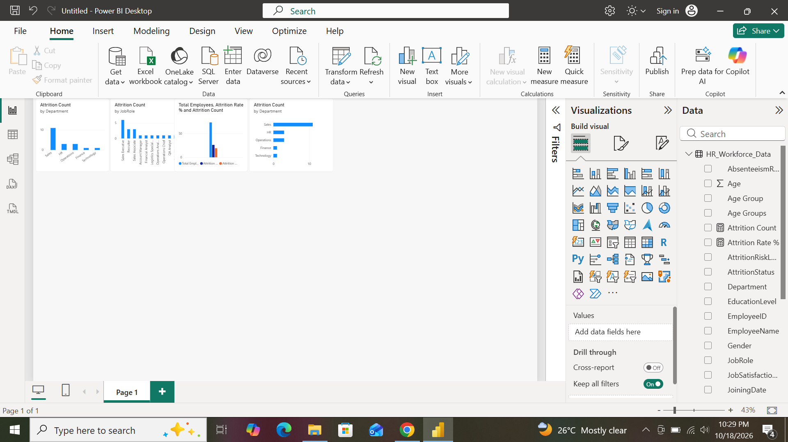

# HR Workforce Insights & Employee Attrition Predictor Dashboard

## 📌 Project Objective
This Business Intelligence application transforms human resources data into an interactive visual dashboard. It helps HR leaders, people analytics teams, and executives monitor workforce demographics, track employee sentiment, and proactively identify turnover risks before they impact the organization's bottom line.

## 🛠️ Technology Stack & Analytical Tools
* **BI Platform:** Power BI Desktop (Engine Version 2026 Optimized)
* **Data Transformation Engine:** Power Query Matrix Transformer M-Logic
* **Modeling & Metrics Language:** Data Analysis Expressions (DAX) 
* **Data Schema Model:** Flat Relational Design Configuration

## 🚀 Key Power Query Steps Applied
1. **Explicit Data Type Mapping:** Set correct text formats and converted numeric string columns into whole numbers.
2. **Text Normalization:** Cleaned out percent text symbols from `AbsenteeismRate` and transformed the values into true numbers.
3. **Experience Level Groups:** Grouped granular tenure fields into standard bands (`0-2 Years`, `3-5 Years`, `6+ Years`).



```dax
Total Employees = COUNT(HR_Workforce_Data[EmployeeID])
Attrition Count = CALCULATE(COUNT(HR_Workforce_Data[EmployeeID]), HR_Workforce_Data[AttritionStatus] = "Yes")
Attrition Rate % = DIVIDE([Attrition Count], [Total Employees], 0) * 100
```

## 📈 Strategic Executive Business Insights
* **Burnout Drivers:** A strong correlation was found between regular overtime work and high attrition, suggesting structural workload challenges.
* **Department Challenges:** The Sales and Tech departments showed the highest overall turnover volumes, pointing to high workplace stress or competitive market dynamics.

## 📸 Dashboard Preview Capture


## 🏁 Project Conclusion
By combining employee profiles with clear turnover counts, this dashboard shifts HR from historical reporting to proactive retention planning. This helps leadership prevent burnout, optimize team workloads, and protect vital talent assets.
